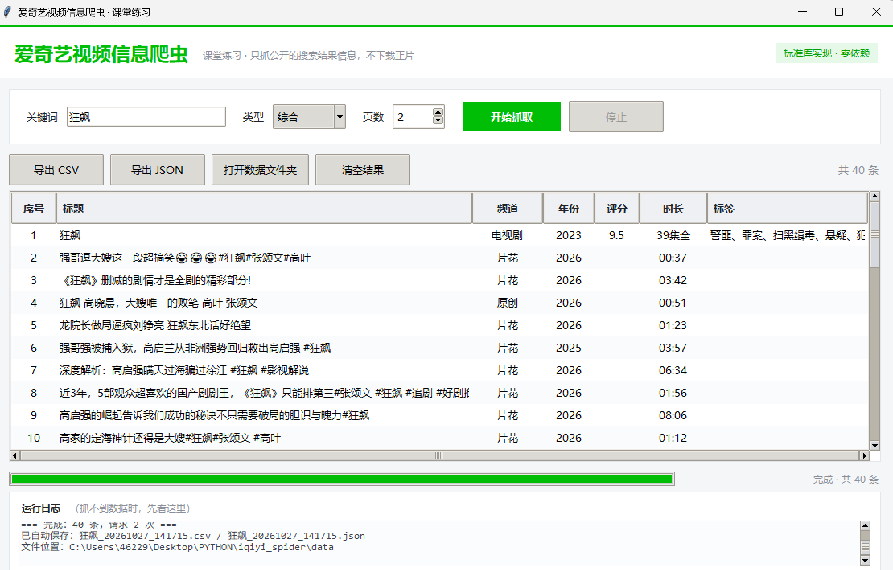

# 爱奇艺视频信息爬虫 · 课堂练习

一个**零第三方依赖**的 Python 小软件：输入关键词，抓取爱奇艺公开搜索结果里的视频信息（标题、频道、年份、评分、时长、标签、简介、链接……），用表格展示，一键导出 CSV / JSON。

两种用法：

| 方式 | 命令 | 适合 |
|---|---|---|
| 图形界面 | `python main.py` | 课堂演示、给同学看 |
| 命令行 | `python cli.py 狂飙 --pages 3` | 写进脚本、批量跑 |



---

## ⚠️ 先说清楚边界（重要）

这个项目**只做一件事**：抓取爱奇艺搜索页面上本来就给所有人看的**公开文字信息**（标题、评分、简介、链接等）。

它**不会**、也**不应该**做这些事：

- ❌ 不下载正片、不下破解视频 —— 正片有版权，且带加密保护；
- ❌ 不绕过 VIP、不破解会员限制；
- ❌ 不模拟登录、不碰别人的账号；
- ❌ 不高频请求（代码里默认每次请求间隔 0.8 秒，就是为了不打扰人家服务器）。

课堂练习的目的是**学会"请求 → 解析 → 保存"这套流程**，不是拿到别人的内容。抓到数据自己看看、做作业可以，**不要商用、不要公开传播、不要当成自己的作品**。

> 顺便说一句：这类接口不是官方文档给的，是打开浏览器 F12 观察出来的。**它随时可能变**。写爬虫的第一课，就是要接受"昨天还能跑，今天 404"。

---

## 🚀 30 秒上手（VSCode）

1. **用 VSCode 打开这个文件夹**（不是打开 `PYTHON` 大文件夹，直接打开 `iqiyi_spider`）：
   文件 → 打开文件夹 → 选 `C:\Users\46229\Desktop\PYTHON\iqiyi_spider`
2. 装 Python 扩展（扩展商店搜 `Python`，微软官方那个）。
3. 按 **F5**，在弹出的列表里选 **「▶ 启动爬虫软件（图形界面）」**。
4. 关键词填 `狂飙`，页数 `2`，点 **开始抓取**。
5. 抓完会自动保存到 `data\` 文件夹，点 **打开数据文件夹** 就能看到 CSV。

命令行也一样（VSCode 里按 `` Ctrl+` `` 开终端）：

```bash
python main.py                 # 打开窗口
python main.py --nogui 狂飙     # 命令行抓 3 页
python cli.py 甄嬛传 --pages 2 --type 长视频优先
python -m unittest discover -s tests -v    # 跑离线测试（不联网）
```

> **不需要 pip install 任何东西。** 整个项目只用 Python 标准库（`urllib` / `json` / `csv` / `tkinter`）。
> 这样你换台电脑、发给同学，都不会出现 `ModuleNotFoundError`。

---

## 📁 目录结构

```
iqiyi_spider/
├── main.py               ← 入口：默认开窗口，加 --nogui 走命令行
├── gui.py                ← 图形界面（tkinter），约 350 行
├── cli.py                ← 命令行版（比 gui.py 短，建议先读它）
├── spider/               ← 爬虫核心，一个文件只管一件事
│   ├── client.py         ← 发请求：伪装浏览器、重试、限速
│   ├── parser.py         ← 解析：把 JSON 变成一行行整齐的数据
│   ├── storage.py        ← 保存：写 CSV / JSON
│   └── crawler.py        ← 编排：翻页、去重、回调进度
├── tests/                ← 离线测试（用真实抓到的样例数据，不联网）
│   ├── fixtures/search_page1.json
│   ├── test_parser.py
│   ├── test_storage.py
│   └── test_crawler.py
├── data/                 ← 抓下来的数据存这里（不进 Git）
├── docs/screenshot.png   ← 界面截图
├── .vscode/              ← F5 一键运行配置（launch.json / tasks.json）
├── requirements.txt      ← 空的，因为不需要装包
└── README.md             ← 你正在看的这个
```

**推荐阅读顺序**：`cli.py` → `spider/parser.py` → `spider/client.py` → `spider/crawler.py` → `spider/storage.py` → `gui.py`。

---

## 🔍 它是怎么工作的

爬虫永远只有三步：**请求 → 解析 → 保存**。多出来的只有"翻页"和"别被封"。

### 第 0 步：先找到"数据从哪来"

打开 <https://so.iqiyi.com> 搜一个词，按 **F12 → Network → 选 Fetch/XHR**，能看到页面在调这个地址：

```
https://mesh.if.iqiyi.com/portal/lw/search/homePageV3?key=狂飙&pageNum=1&mode=0
```

返回的是一大坨 JSON（不是网页 HTML）。**这一步是整个爬虫里最有技术含量的**：找到接口，后面就只是搬砖。

地址里那个 `mode` 参数就是"分类"，项目里试出来的对应关系是：

| 界面上的选项 | mode | 效果 |
|---|---|---|
| 综合 | 0 | 混排，最相关的长视频排最前面（默认） |
| 长视频优先 | 5 | 剧集 / 电影排在前面，后面仍会混短视频 |
| 短视频 | 3 | 只要短视频 |

> 注意：这三个数字**不是官方文档给的**，是打开 F12 一个个试出来的，所以叫"经验值"。
> 哪天你发现"长视频优先"返回的全是综艺，很正常 —— 接口改了就跟着改。

### 第 1 步：发请求（`spider/client.py`）

```python
request = urllib.request.Request(url, headers=headers)
with urllib.request.urlopen(request, timeout=15) as response:
    return response.read().decode("utf-8-sig")
```

三个细节，都是真会踩的坑：

- **`User-Agent`**：不伪装成浏览器，很多网站直接给你 403；
- **`utf-8-sig`**：接口返回开头可能有个看不见的 BOM 字符，不去掉 `json.loads` 会报错；
- **重试 + 限速**：网络抖动很常见，`for attempt in range(1, retries+1)` 试三次；每次请求之间 `sleep(0.8)`。

### 第 2 步：解析（`spider/parser.py`）

接口里一条结果长这样（简化过）：

```python
{
  "template": 101,
  "s3": "剧集类型展示",
  "albumInfo": {
    "title": "狂飙",
    "channel": "电视剧,2",
    "rating": 9.5,
    "year": {"key": "年份", "value": "2023"},
    "actors": {"key": "主演", "value": [{"title": "张译"}, {"title": "张颂文"}]},
    "pageUrl": "https://www.iqiyi.com/v_xkt6z3z798.html"
  }
}
```

解析器要做的就是把这种"歪歪扭扭"的结构，拍平成固定的一行：

```python
{"title": "狂飙", "channel": "电视剧", "year": "2023", "rating": "9.5", "actors": "张译、张颂文", ...}
```

> 这里有个真实的坑，值得单独记一下：**同一个字段，在不同类型的数据里装的东西不一样。**
> 剧集和短视频的 `subscriptContent` 是时长（`"39集全"`、`"00:37"`），
> 但**电影**的 `subscriptContent` 装的是评分（`"9.0"`），真正的时长在 `duration`（毫秒）里。
> 第一版代码直接返回了 `subscriptContent`，结果《流浪地球2》的时长变成 `9.0`。
> 后来改成"带「集」或「:」的才算时长，否则用毫秒数"，才修好（`_duration_of`）。
> 写爬虫时，"先看 3 条不同类型的数据再写解析"这句话能省掉一半的 bug。

`parser.py` 里全是**纯函数**：给它数据，它给你结果，不联网、不读文件。所以 `tests/` 里能用保存下来的真实 JSON 反复验证它。

### 第 3 步：翻页 + 去重（`spider/crawler.py`）

```python
for page in range(1, pages + 1):
    payload = client.get_json(parser.build_search_url(keyword, page, mode))
    for record in parser.parse_search_payload(payload):
        key = record["url"]
        if key not in seen:      # 去重：不同页可能给出同一条
            seen.add(key)
            records.append(record)
```

`crawl()` 里有三个回调函数（`on_log` / `on_progress` / `on_page`）—— 这样**界面和命令行复用同一套逻辑**，界面只管"收到消息就刷新"。

### 第 4 步：保存（`spider/storage.py`）

CSV 用 `encoding="utf-8-sig"` 保存。那个 `-sig` 就是文件头的 BOM，**不加的话 Excel 双击打开会全是乱码**。

---

## 📊 抓到的字段

| 字段 | 说明 | 例子 |
|---|---|---|
| 序号 | 导出时的行号 | 1 |
| 标题 | 视频名 | 狂飙 |
| 频道 | 分类 | 电视剧 / 电影 / 片花 / 综艺 |
| 来源 | 接口给的条目类型 | 剧集类型展示 / 短视频 / 电影类长视频 |
| 年份 | 首播/发布年份 | 2023 |
| 地区 | 制作地区（长视频才有） | 内地 |
| 评分 | 爱奇艺评分（长视频才有） | 9.5 |
| 热度 | 热度值 | 3147 |
| 时长 | 剧集是"39集全"，短视频是"00:37"，电影是毫秒数换算的"2:53:11" | 39集全 |
| 主演 | 演员/导演 | 张译、张颂文 |
| 标签 | 最多 8 个标签 | 警匪、罪案、悬疑 |
| 简介 | 剧情简介 | 由金牌导演徐纪周执导…… |
| VIP | 是否会员内容 | VIP / 空 |
| 链接 | 视频页地址 | https://www.iqiyi.com/v_xxx.html |
| 视频ID | 爱奇艺内部编号 | 5328486914190101 |

---

## 🧰 常见问题（报错了先看这里）

| 现象 | 原因 | 怎么办 |
|---|---|---|
| 日志里 `HTTP 404` / 返回的不是 JSON | **接口变了**（最常见） | 打开搜索页 F12 看现在调哪个地址，改 `spider/parser.py` 里的 `SEARCH_API` |
| `网络错误：<urlopen error ...>` | 没联网 / 开了代理 / 被限流 | 确认能正常打开爱奇艺网页；把 `--delay` 调大 |
| 抓到的条数是 0 | 关键词太怪、或接口返回空 | 换个词试试，比如 `狂飙`、`流浪地球` |
| CSV 用 Excel 打开乱码 | 编码问题 | 本项目已用 `utf-8-sig`，若还乱码：Excel → 数据 → 从文本导入，选 UTF-8 |
| 导出时 `PermissionError` | 文件正被 Excel 打开着 | 关掉 Excel 再导出 |
| 界面白屏、"未响应" | tkinter 主线程在干重活 | 本项目已用后台线程 + `queue` 解决；改代码时别在主线程里发请求 |
| 按 F5 没反应 | 没装 Python 扩展 / 选错解释器 | 装微软 Python 扩展；`Ctrl+Shift+P` → `Python: Select Interpreter` |
| 控制台里 emoji 报 `UnicodeEncodeError` | Windows 终端默认 GBK | `cli.py` 已经 `sys.stdout.reconfigure(encoding="utf-8")`；自己写脚本时记得加 |
| 测试里 `PermissionError` | 临时目录被杀毒/沙箱锁住 | 项目已把测试临时文件放在 `tests/_tmp`，并 `ignore_errors` |

---

## ✏️ 作业（由易到难，做完一个打个勾）

> 每题都写了"改哪里"，但**先自己想 10 分钟**。卡住超 10 分钟再来问。

- [ ] **1. 改默认值**（热身）
      把界面默认关键词从 `狂飙` 改成你最近在追的剧；把默认页数改成 2。
      改哪里：`gui.py` 里 `keyword_var = tk.StringVar(value=...)`。

- [ ] **2. 加一个字段：上传者**
      短视频结果里有 `uploader`（上传者），长视频没有。
      改哪里：`parser.py` 的 `FIELDS` 加一行 → `normalize_item()` 里把值取出来 → 界面/CSV 会自动多一列。
      验收：抓 `狂飙`，第二行开始能看到「上传者」有值。

- [ ] **3. 只保留评分 ≥ 9 的长视频**
      在 `crawler.py` 里过滤。提示：`rating` 是字符串，空字符串要先排除。
      验收：导出 CSV 里只剩评分 9 分以上的。

- [ ] **4. 加"按评分排序"**
      在 `cli.py` 里，保存前对 `report.records` 排序。提示：`sorted(..., key=lambda r: float(r["rating"] or 0), reverse=True)`。

- [ ] **5. 用 `requests` 重写 `client.get_text()`**
      `pip install requests`，对比一下代码少了几行、多了哪些方便（`resp.json()`、`resp.raise_for_status()`）。
      验收：命令行能正常抓到数据。

- [ ] **6. 给界面加一个"只看免费"的勾选框**
      提示：`tk.BooleanVar` + `Checkbutton`；在 `on_page` 收到新记录时过滤掉 `vip == "VIP"` 的。

- [ ] **7. 把结果画成图**
      用 `tkinter.Canvas` 画一个"频道分布"柱状图（不用装任何库）。
      提示：先 `collections.Counter(record["channel"] for record in records)`。

- [ ] **8. 进阶（选做）：抓详情页**
      点开一个视频页，F12 看它调了哪个接口拿"分集列表 / 播放量"，再写一个 `detail.py`。
      ⚠️ 只碰公开数据，**不要碰播放地址、不要碰会员内容**。

---

## 🌿 Git 练习（和你日志里的目标对齐）

这个项目已经放好了 `.gitignore`，第一次提交只要四步：

```bash
cd C:\Users\46229\Desktop\PYTHON\iqiyi_spider
git init
git add .
git status              # 看一眼：data/ 和 __pycache__ 应该被忽略
git commit -m "feat: 爱奇艺视频信息爬虫（课堂练习第一版）"
```

之后每做完一个作业，就 `git add .` + `git commit -m "作业2: 加上传者字段"`。
**改坏了怎么办**：`git checkout -- 文件名` 就能恢复到上次提交的样子。

---

## 📚 会用到 / 会学到的知识点

| 知识点 | 出现在哪个文件 |
|---|---|
| `urllib.request` 发请求、自定义 Header | `spider/client.py` |
| `json.loads` 解析 JSON | `spider/client.py` |
| 函数 / 字典 / 列表推导式 | `spider/parser.py` |
| 异常处理 `try/except`、重试 | `spider/client.py`、`crawler.py` |
| `csv.DictWriter`、`encoding="utf-8-sig"` | `spider/storage.py` |
| `pathlib.Path` 处理路径 | `spider/storage.py` |
| 类与实例（`class HttpClient`） | `spider/client.py` |
| 回调函数（函数当参数传） | `spider/crawler.py` |
| `threading` 后台线程 + `queue` | `gui.py` |
| `tkinter` 布局、`ttk.Treeview` 表格 | `gui.py` |
| `argparse` 命令行参数 | `cli.py` |
| `unittest` 单元测试 | `tests/` |
| 模块化：一个文件只干一件事 | 整个 `spider/` |

---

## 💬 最后

这段代码是给你**读、改、拆**的，不是给你交上去就完事的。

两个建议：

1. **每个文件都从第一行读到最后一行**，遇到看不懂的函数就 `python -c "help(...)"` 或者直接改一行跑一次看结果。读代码的速度是练出来的。
2. **改坏不怕**。有 Git 兜底，`git checkout` 一下就回来了。真正学不会的是"从来不敢改"。

有报错、有不理解的地方，直接把整段报错贴给我，我们从最后一行开始看。
